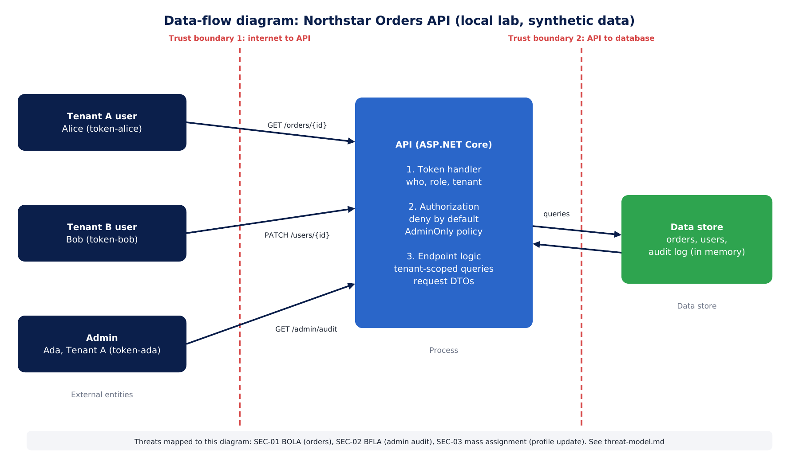

# northstar-secure-saas-api

A small multi-tenant ASP.NET Core API for a fictional company, **Northstar Orders**. I planted three authorization flaws on labeled branches, fixed each one on `main`, and wrote regression tests, including bypass tests, to show each fix holds.

> **Safety:** Branches named `vulnerable/*` contain deliberately flawed code for learning. Run them locally only. Do not deploy them. All data is synthetic and the company is fictional.

## Why this matters

Two customers (Tenant A and Tenant B) share one API. If tenant isolation or role checks fail, one customer can read or change another customer's data. This project shows how that happens, how to fix it, and how to keep it fixed.

## Architecture



Clients call the API with a token that carries a user, a role and a tenant. The server checks the tenant and role on every request.

## Findings

| ID | Flaw | Impact (synthetic data) | Fix | Report | Status |
| --- | --- | --- | --- | --- | --- |
| SEC-01 | Broken object-level authorization (BOLA) | Tenant A can read Tenant B's orders by changing the ID | Tenant-scoped query, same 404 for missing and foreign orders | [report](docs/findings/SEC-01.md) | Fixed |
| SEC-02 | Broken function-level authorization (BFLA) | A normal user can read the admin audit log | Role policy on the endpoint, deny by default | [report](docs/findings/SEC-02.md) | Fixed |
| SEC-03 | Mass assignment | A user can set their own role or tenant in a profile update | Explicit request type with allowed fields only | [report](docs/findings/SEC-03.md) | Fixed |

## Tests

- **20 tests** in total, all passing on `main`
- **14 bypass tests** (alternate ID, other tenant, omitted tenant claim, other HTTP method, trailing slash, different case, uppercase and nested JSON fields, another user's profile)
- Each fix has tests that fail on its `vulnerable/*` branch:

| Branch | Failing tests | Passing tests |
| --- | --- | --- |
| `vulnerable/sec-01-bola` | 4 | 16 |
| `vulnerable/sec-02-bfla` | 4 | 16 |
| `vulnerable/sec-03-mass-assignment` | 3 | 17 |

## Quick start

Requires the [.NET 8 SDK](https://dotnet.microsoft.com/download/dotnet/8.0).

```bash
git clone https://github.com/moni-kumari-sec/northstar-secure-saas-api.git
cd northstar-secure-saas-api
dotnet test --filter Category=Security      # expected on main: 20 passed
dotnet run --project src/Northstar.Api
```

To see a flaw, check out a vulnerable branch and run the same tests:

```bash
git checkout vulnerable/sec-01-bola
dotnet test --filter Category=Security      # expected: 4 failed
```

Lab tokens for local requests: `token-alice` (Tenant A user), `token-bob` (Tenant B user), `token-ada` (Tenant A admin), for example:

```bash
curl -H "Authorization: Bearer token-alice" http://localhost:5000/orders/1001
```

The port is printed by `dotnet run`.

## API

| Route | Purpose | Rule |
| --- | --- | --- |
| `GET /orders/{id}` | Read an order | Own tenant only (SEC-01) |
| `GET /admin/audit` | Read the audit log | Admin role only (SEC-02) |
| `GET /users/{id}` | Read own profile | Own profile only |
| `PATCH /users/{id}` | Update own display name or email | Allowed fields only (SEC-03) |

Authentication is a lab-only fake token handler. It is not production authentication.

## Threat model

[docs/threat-model/threat-model.md](docs/threat-model/threat-model.md): draft with 8 threats. Rows 1 to 3 map to the findings above. The remaining rows are open and not yet tested.

## What I did not test

- Production deployment, network-level attacks, and performance under load
- Real authentication: token signing, expiry, refresh, login rate limiting
- Persistent storage, SQL injection, invoices and refund requests
- Parsers other than JSON

## What I would improve in a real system

Centralize authorization in one policy layer, use database-level tenant filters so a forgotten check cannot expose data, add audit events for every denied request, and run these tests in CI on every change.

## License

MIT. See [LICENSE](LICENSE).
